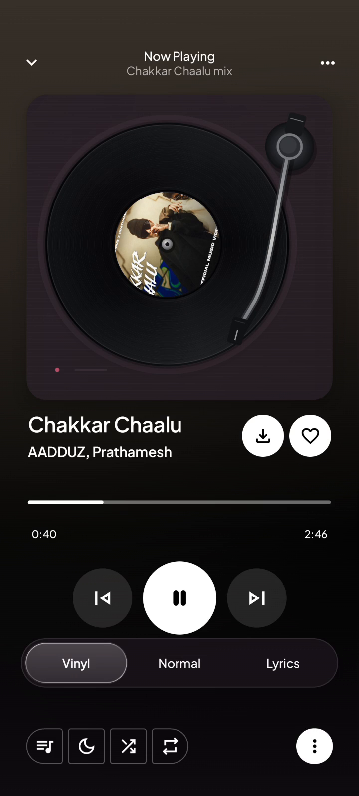

# KAI Music

An independent open-source music experience, built upon the foundation of Echo Music.

## Download

<!-- kai-downloads:start -->
**No stable KAI release is available yet.** The current download is a debug-signed preview, not a stable build.

[](https://github.com/dipakdhurve9975-lgtm/KAI-Music/releases/download/kai-preview-1.4.9/KAI-universal-gms-preview.apk)

Current preview: **1.4.9**, Universal GMS, Android 8.0+.

[Matching preview source ZIP](https://github.com/dipakdhurve9975-lgtm/KAI-Music/releases/download/kai-preview-1.4.9/KAI-Music-source-1.4.9.zip)

[View All Releases](https://github.com/dipakdhurve9975-lgtm/KAI-Music/releases) · [Source Code](https://github.com/dipakdhurve9975-lgtm/KAI-Music)

Universal includes ARM64, ARMv7, x86 and x86_64 native libraries. GMS enables Google Cast; Google-dependent features need compatible services. No non-GMS APK is currently published.
<!-- kai-downloads:end -->

## Overview

KAI is an independently maintained Android music application based on [Echo Music](https://github.com/EchoMusicApp/Echo-Music). It keeps the original playback and library foundation while adding KAI's visual identity and player customizations. Maintained by [@dipakdhurve9975-lgtm](https://github.com/dipakdhurve9975-lgtm).

## Features

- Vinyl, Normal and Lyrics presentations share the same playback session.
- Animated vinyl record and remembered Ambient Normal/Vinyl presentation.
- Five lyric presentations, selectable typefaces and restrained glow. Synchronization depends on genuine provider timestamps; untimed lyrics remain readable. The 1.4.9 candidate repairs the frozen lyric callback; real progression, scrolling and paused seeking were checked on the connected A001 phone.
- Existing search, library, playlists, downloads and background playback are retained from the original project.
- Dark/light themes, reduced-motion support and a home dock that hides while scrolling down.

These features are implemented in source. A successful build does not establish that every integration works on every device; see [verification and limitations](docs/COMPLIANCE_REPORT.md).

## Screenshots

Existing KAI vinyl-player capture (not a mockup; predates the About changes):



## Installation

1. Download the APK from a KAI release above and compare its SHA-256 with the release checksum file.
2. Open the APK on Android 8.0 or newer. Allow installation from your chosen browser/file manager when Android asks.
3. Install over a compatible KAI preview to preserve data. Preview updates require the same application ID and signing certificate. Do not uninstall to fix a signature mismatch without backing up your data.

The current public APK is a **debug-signed preview**, package `echo.music.iad1tya.debug`. A future production build uses the existing release package configuration and is a separate installation identity; it must not silently replace the preview. KAI 1.4.9 adds optional checks of KAI releases only, with stable as the default and previews requiring opt-in. Downloads and Android installation require user action. Older 1.4.8 installations need one manual compatible update to receive this updater. No silent installation is used.

## Build From Source

Use the matching source ZIP attached to a historical preview release, or clone the full source after this prepared change is approved and pushed:

```sh
git clone https://github.com/dipakdhurve9975-lgtm/KAI-Music.git
cd KAI-Music
```

Install JDK 21, Android SDK platform `android-37.0`, build-tools 36.0.0 and NDK 28.2.13676358. Set `ANDROID_HOME` or an untracked `local.properties` with `sdk.dir`. Then:

```sh
chmod +x gradlew
./gradlew :app:assembleUniversalGmsDebug -PkaiPublicBuild=true -PFLOW_NEURO_API_KEY= --max-workers=2
./gradlew :app:testUniversalGmsDebugUnitTest :core:testDebugUnitTest :lyrics:testDebugUnitTest :youlyplus:testDebugUnitTest
```

On Windows use `gradlew.bat`. No Firebase configuration is needed for the public build. Service integrations can require your own credentials; private OAuth/API secrets and signing keys are not included. See [SETUP.md](SETUP.md) and [release instructions](docs/RELEASING.md). Fresh developer debug builds have their own signing key and cannot necessarily update the published preview.

## What's Different in KAI?

KAI introduces its own connected K/music-note branding, vinyl rendering, liquid selectors, Ambient presentations, five lyric styles/typeface controls, home/library and dock refinements, spiral loading, and lifecycle/reduced-motion gating. It retires the inherited automatic Echo update feed and adds a separate KAI-only updater with explicit verified downloads and Android installation approval. These are modifications to an existing application, not claims of original authorship of its playback engine, providers or library. [Dated modification inventory](MODIFICATIONS.md).

## Built Upon Echo Music

KAI Music is an independent modification of Echo Music, an open-source Android music application originally developed by Aditya and its contributors. Echo Music provided the foundation that made KAI possible.

KAI builds upon that foundation through independent development, customization, experimentation, and improvements. We sincerely appreciate the original developers and the open-source community.

KAI is not an official Echo Music release and is not affiliated with or endorsed by the original development team.

Original repository: [EchoMusicApp/Echo-Music](https://github.com/EchoMusicApp/Echo-Music).

## Original Creator

[Aditya (@iad1tya)](https://github.com/iad1tya) — original Echo Music creator. [Original project](https://github.com/EchoMusicApp/Echo-Music) · [Verification evidence](docs/PROJECT_AUDIT.md).

## Contributors

Thank you to the [original Echo Music contributors](https://github.com/EchoMusicApp/Echo-Music/graphs/contributors). Their work remains credited in [NOTICE.md](NOTICE.md) and source headers. The [KAI repository contributors](https://github.com/dipakdhurve9975-lgtm/KAI-Music/graphs/contributors) are a separate group; the current maintainer does not claim ownership of all inherited work.

## Special Thanks

A sincere thank you to Aditya (@iad1tya) and all contributors to Echo Music. Your dedication to open-source development provided the foundation and inspiration for KAI Music. The time, creativity, and effort invested in Echo Music helped make this project possible. Thank you for sharing your work and encouraging developers to keep learning, experimenting, and improving software. We deeply appreciate your contribution.

The original project and its dependency acknowledgments remain in [NOTICE.md](NOTICE.md). KAI also retains the following specific acknowledgments:

| Project | Contribution |
| --- | --- |
| [Echo Music](https://github.com/EchoMusicApp/Echo-Music) | Original application, playback, data, providers and UI foundation modified by KAI; original lyric synchronization used as the regression reference |
| [Compose Floating Tab Bar](https://github.com/elyesmansour/compose-floating-tab-bar) | Apache-2.0 vendored tab/accessory layout extended with KAI's expanded liquid navigation slot |
| [Backdrop](https://github.com/Kyant0/backdrop) | Apache-2.0 vendored backdrop effects reused for bounded player/navigation glass with fallbacks |
| [Plus Jakarta Sans](https://github.com/tokotype/PlusJakartaSans) | Default bundled typography, OFL-1.1 |
| [Google Sans Flex](https://github.com/googlefonts/googlesans-flex) | Official OFL-1.1 edition replaces an inherited restricted font binary; resource IDs/preferences preserved |
| [Outfit](https://github.com/Outfitio/Outfit-Fonts) and [BBH](https://github.com/Studio-DRAMA/BBH) | Existing optional fonts; OFL notices included |

## License

GPL-covered code and KAI modifications are distributed under [GNU GPL v3.0](LICENSE), without warranty. Original copyrights remain with their respective owners. Third-party components and assets may have separate licenses; they are not automatically GPL merely because they ship in the app. See [notices](NOTICE.md), [dependency inventory](docs/dependency-inventory.json) and the [compliance review](docs/COMPLIANCE_REPORT.md), including unresolved obligations.

Each new draft release includes the exact committed source, Gradle/build scripts, APK/source checksums and build metadata. Historical preview tags point to documentation-only commits: **use their attached `KAI-Music-source-*.zip`, not GitHub's automatically generated source archive**, to obtain matching application source.

## Disclaimer

KAI Music is an independent open-source modification of Echo Music. KAI is not officially affiliated with, endorsed by, or maintained by the original Echo Music developers. Original copyrights remain with their respective owners. GPL-covered software is distributed under GNU GPL-3.0. Third-party services and content remain subject to their respective terms and applicable laws. Open-source licensing does not grant rights to stream or download third-party content. No official association with YouTube or Google is claimed.
